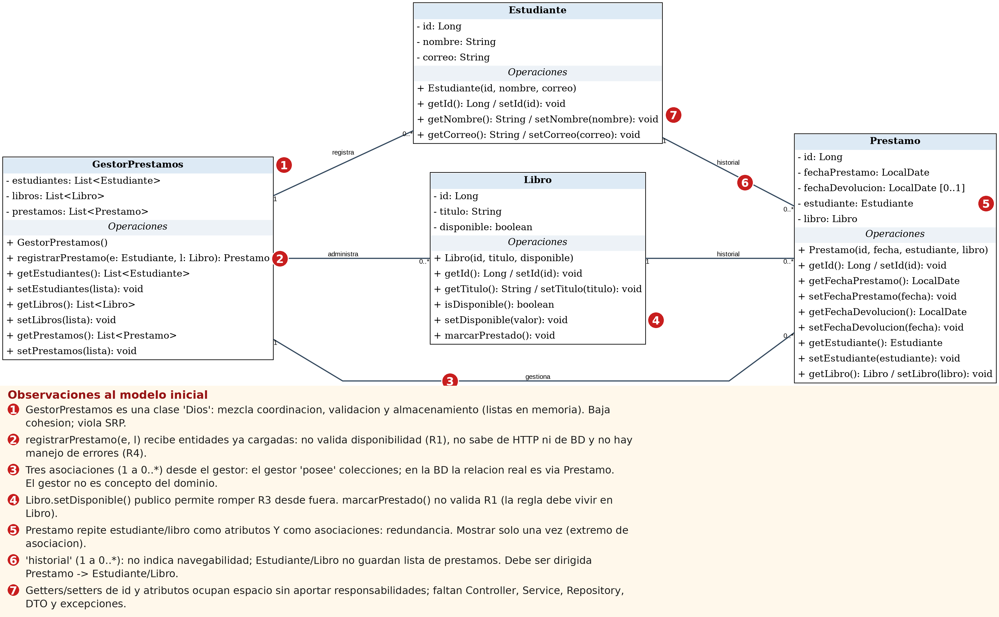

# 01 · Análisis del modelo inicial (Actividad 1)

**Integrantes:** Santiago Ortega Bolaños y Johan Mosquera Montilla

## 1. Datos y operaciones del dominio

| Clase | Datos | Operaciones |
|---|---|---|
| Estudiante | id, nombre, correo | consultar sus datos |
| Libro | id, título, disponible | consultar disponibilidad, marcarse como prestado |
| Préstamo | id, estudiante, libro, fechaPrestamo, fechaDevolucion | saber si está activo |
| (GestorPrestamos) | — | registrar préstamo, listar préstamos |

## 2. ¿Por qué Libro–Préstamo y Estudiante–Préstamo son asociaciones y no composiciones?

Una **composición** implica que la parte no existe sin el todo y que comparten ciclo de vida (si se elimina el todo, se eliminan las partes). Aquí no ocurre:

- Un **libro** existe antes de cualquier préstamo y sigue existiendo cuando el préstamo termina; además, un mismo libro participa en **varios préstamos históricos** (R5). Ni el libro "contiene" préstamos ni el préstamo "contiene" al libro.
- Un **estudiante** existe independientemente de sus préstamos y puede tener muchos.
- El préstamo solo **referencia** a ambos (necesita conocerlos, R2). Eso es una **asociación** dirigida `Prestamo → Libro` y `Prestamo → Estudiante` con multiplicidad `0..* → 1`.

## 3. Operaciones necesarias para consultar, validar y guardar

| Propósito | Operación |
|---|---|
| Consultar | `findById(estudianteId)`, `findById(libroId)`, `findAll()` de préstamos |
| Validar | existencia de estudiante y libro; `Libro.marcarPrestado()` verifica disponibilidad (R1); formato de la solicitud (`@NotNull`) |
| Guardar | `save(libro)` (nuevo estado de disponibilidad) y `save(prestamo)`, dentro de una transacción |

## 4. Responsabilidades que faltan en el modelo inicial

**Para HTTP** (no pertenecen al dominio):
- Recibir la petición `POST /api/prestamos` y convertir JSON ↔ objetos (DTO `PrestamoRequest` / `PrestamoResponse`).
- Validar el formato de entrada (campos obligatorios).
- Traducir el resultado a códigos de estado (201, 400, 404, 409, 200) → `PrestamoController` + `GlobalExceptionHandler`.

**Para datos**:
- Buscar y guardar entidades en una base de datos → repositorios (`EstudianteRepository`, `LibroRepository`, `PrestamoRepository`).
- Mapear clases a tablas (anotaciones JPA) y garantizar atomicidad (`@Transactional`), de modo que una solicitud fallida no deje un préstamo a medias (R4).

## 5. Observaciones al modelo inicial

1. **GestorPrestamos es una clase "Dios"**: mezcla coordinación, validación y almacenamiento (listas en memoria). Tiene baja cohesión y viola el principio de responsabilidad única (SRP).
2. **registrarPrestamo(e, l) recibe entidades ya cargadas**: no valida la disponibilidad (R1), no sabe de HTTP ni de la base de datos, y no tiene manejo de errores (R4).
3. **Tres asociaciones (1 a 0..\*) desde el gestor**: el gestor "posee" las colecciones; la relación real en la base de datos es a través de Prestamo. El gestor no es un concepto del dominio.
4. **Libro.setDisponible() es público** y permite romper R3 desde fuera; marcarPrestado() no valida R1. La regla debe vivir dentro de Libro.
5. **Prestamo repite estudiante y libro** como atributos y también como asociaciones: hay redundancia. Deben mostrarse una sola vez, como extremo de asociación.
6. **Las asociaciones "historial" (1 a 0..\*) no indican navegabilidad**: Estudiante y Libro no guardan lista de préstamos. Deben ser asociaciones dirigidas Prestamo -> Estudiante y Prestamo -> Libro.
7. **Los getters y setters de id y atributos** ocupan espacio sin aportar responsabilidades, y faltan Controller, Service, Repository, DTO y excepciones.
