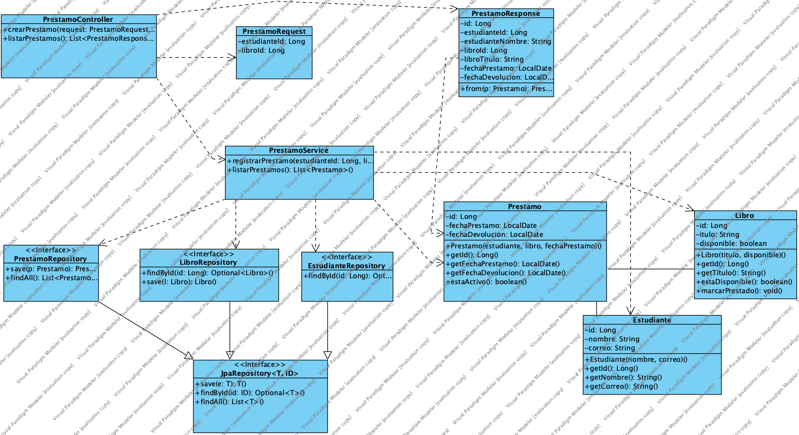
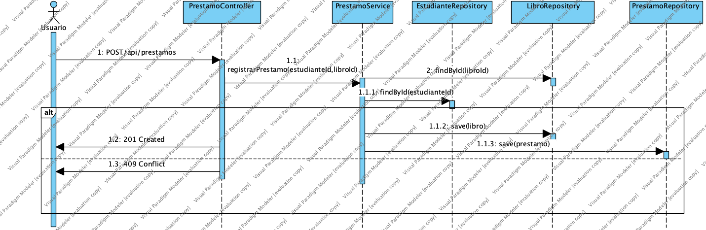

# 03 · Diagramas UML

> Los diagramas se elaboran en **Visual Paradigm** y se exportan como PNG a `docs/diagramas/`.

## 1. Diagrama de clases por capas

> ⚠️ **Pendiente de exportar desde Visual Paradigm** (`docs/diagramas/vp-clases-capas.png`).

### Justificación de las relaciones

| Relación | Tipo UML | Justificación |
|---|---|---|
| `Prestamo → Estudiante` | Asociación dirigida, `0..*` → `1` | Un préstamo conoce a un único estudiante; un estudiante puede tener muchos préstamos. Ciclos de vida independientes. |
| `Prestamo → Libro` | Asociación dirigida, `0..*` → `1` | Un préstamo conoce a un único libro; un libro tiene varios préstamos históricos (R5). Ciclos de vida independientes. |
| `PrestamoController ⇢ PrestamoService` | Dependencia | El controller usa el servicio (inyectado por constructor) para delegar el caso de uso. |
| `PrestamoService ⇢ EstudianteRepository / LibroRepository / PrestamoRepository` | Dependencia | El servicio usa los repositorios para buscar y guardar. |
| `PrestamoController ⇢ PrestamoRequest / PrestamoResponse` | Dependencia | Los DTO solo se usan en la capa HTTP. |
| `EstudianteRepository`, `LibroRepository`, `PrestamoRepository` → `JpaRepository<T, Long>` | Generalización (herencia de interfaces) | Las interfaces heredan las operaciones CRUD de Spring Data; Spring genera la implementación. |
| `LibroNoDisponibleException`, `RecursoNoEncontradoException` → `RuntimeException` | Generalización | Excepciones no comprobadas que provocan rollback. |
| Agregación / composición | **No se usan** | Ninguna clase es dueña del ciclo de vida de otra (ver docs/01, sección 2). |

Dirección obligatoria: **Controller → Service → Repository**. No existe ninguna flecha Controller → Repository ni Service → DTO/HTTP.

## 2. Diagrama de secuencia «Registrar préstamo»

> ⚠️ **Pendiente de exportar desde Visual Paradigm** (`docs/diagramas/vp-secuencia-prestamo.png`).

### Tabla mensaje → operación

| # | Emisor → Receptor | Mensaje | Operación en el código |
|---|---|---|---|
| 1 | Cliente → `PrestamoController` | `POST /api/prestamos {estudianteId, libroId}` | `crearPrestamo(@Valid PrestamoRequest)` |
| 2 | `PrestamoController` → `PrestamoService` | registrar préstamo | `registrarPrestamo(estudianteId, libroId)` |
| 3 | `PrestamoService` → `EstudianteRepository` | buscar estudiante | `findById(estudianteId)` → `Optional<Estudiante>` |
| 4 | `PrestamoService` → `LibroRepository` | buscar libro | `findById(libroId)` → `Optional<Libro>` |
| 5 | `PrestamoService` → `Libro` | validar y marcar prestado | `marcarPrestado()` |
| 6 | `PrestamoService` → `Prestamo` | crear | `new Prestamo(estudiante, libro, LocalDate.now())` |
| 7 | `PrestamoService` → `LibroRepository` | guardar libro | `save(libro)` |
| 8 | `PrestamoService` → `PrestamoRepository` | guardar préstamo | `save(prestamo)` → `Prestamo` |
| 9 | `PrestamoController` → Cliente | respuesta | `ResponseEntity.status(201).body(PrestamoResponse.from(prestamo))` |

**Fragmentos alternativos (`alt`)**: si en 3 o 4 no hay resultado → `RecursoNoEncontradoException` → `GlobalExceptionHandler` → **404**; si en 5 el libro no está disponible → `LibroNoDisponibleException` → **409**; si en 1 falta un campo → `MethodArgumentNotValidException` → **400** (no se llega al servicio). En todos los casos no se guarda ningún préstamo (R4).
